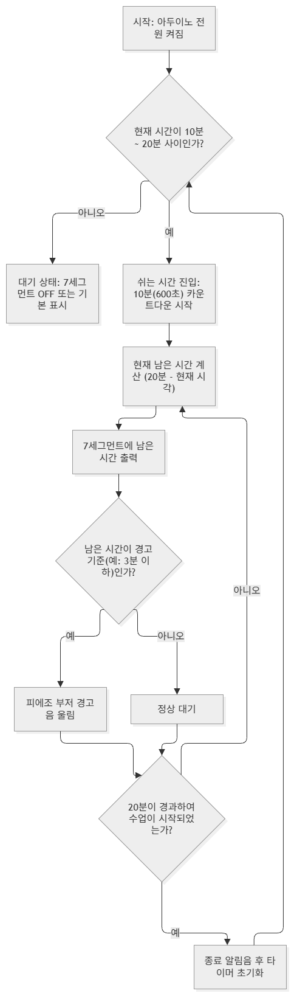

# 🛡️ 고등학교 정보·컴퓨터 동아리: 아두이노 학교생활 안전 프로젝트

보유한 아두이노 부품 (Arduino Uno, 센서, LED, 디스플레이 등) 을 활용하여 학교생활 속 안전과 편의를 개선하는 시제품(Prototype)을 제작하는 3시간 집중 동아리 프로젝트입니다.

---

## 👥 팀 구성 및 역할 분담 (총 10명 + 지도교사 1명)
* **총괄 및 기술 지도:** 지도교사 (1명)
* **팀별 인원:** 총 3개 팀 (각 팀당 2명 구성)
---
## 👥 준비물 다운로드 및 설치
* **📥 Git for Windows 설치 및 Git Bash 실행 순서**
  * **설치 파일 다운로드:** [Git for Windows 공식 다운로드 페이지](https://git-scm.com/install/windows)에 접속하여 **[Git for Windows/x64 Setup](https://git-scm.com/download/win)** 링크를 클릭해 설치 파일을 다운로드합니다.
  * **프로그램 설치:** 다운로드한 설치 파일(`Git-2.56.0.4-64-bit.exe`)을 실행하고, 화면의 안내(Next)에 따라 기본 설정으로 설치를 완료합니다.
* **💻 윈도우 파워쉘(PowerShell) 실행 순서**
  * **시작 메뉴 열기:** 키보드의 **[Windows (윈도우)]** 키를 누르거나, 화면 아래 작업표시줄에 있는 **[시작(Windows 아이콘)]** 버튼을 클릭합니다.
  * **프로그램 검색:** 검색창에 **`PowerShell`** 또는 **`Windows PowerShell`**을 입력합니다.
  * **실행하기:** 검색된 **[Windows PowerShell]** 앱 아이콘을 클릭하여 실행합니다.
  * **빠른 단축키 활용 (선택):** 바탕화면 빈 곳에서 **[Shift + 우클릭]** 을 누른 뒤 **[PowerShell 창 열기(S)]** 를 선택하여 현재 폴더 위치에서 바로 실행할 수도 있습니다.
  * **바탕화면 단축키:** **[윈도우키 + D]**

---

* **📥 윈도우 파워쉘(PowerShell)을 이용한 Git 클론 방법**
  * **작업 폴더 이동:** 프로젝트를 저장할 폴더로 이동합니다. (예: 바탕화면으로 이동하려면 아래 명령어 입력)
    ```powershell
    cd $HOME\Desktop
    ```
  * **저장소 클론(Clone):** 파워쉘 창에 아래 명령어를 복사하여 붙여넣고 실행(`Enter`)합니다.
    ```powershell
    git clone https://github.com/seongui2030/arduino.git
    ```
---

* **🔌아두이노 IDE 다운로드 및 설치:**
     * **아두이노 IDE 다운로드:** [Arduino IDE](https://apps.microsoft.com/detail/9nblggh4rsd8?hl=ko-KR&gl=KR) 에서 **[다운로드]** 를 클릭하여 프로그램을 내려받기 합니다.
     * **아두이노 설치:** 다운로드 폴더에서 내려받은 설치 프로그램 파일 ( 'Arduino IDE Installer.exe')를 더블클릭하여 설치를 진행합니다.

* **💻 시작 메뉴에서 아두이노 IDE 실행 순서**
  * **시작 메뉴 열기:** 키보드의 **[Windows (윈도우)]** 키를 누르거나, 화면 아래 작업표시줄에 있는 **[시작(Windows 아이콘)]** 버튼을 클릭합니다.
  * **프로그램 검색:** 검색창에 **`Arduino IDE`** 를 입력하거나 앱 목록에서 **[Arduino IDE]** 를 찾습니다.
  * **실행하기:** **Arduino IDE** 앱 아이콘을 클릭하여 프로그램을 실행합니다.
  * **프로젝트 폴더 열기:** 
    * 아두이노 IDE가 실행되면 상단 메뉴바에서 **[파일 (File)]** $\rightarrow$ **[기본 설정...]** 를 클릭합니다.
    * **스케치북 위치:** **[검색]** 버튼을 눌러 바탕화면에 있는 **`arduino`** 폴더(`C:\Users\User\Desktop\arduino`)를 선택 후 **[확인]** 버튼을 클릭 합니다.
    * 상단 메뉴바에서 **[툴 (Tools)]** $\rightarrow$ **[보드 (Board)]** $\rightarrow$ **[Arduino Uno]** 를 선택합니다.
    * **[툴 (Tools)]** $\rightarrow$ **[포트 (Port)]** 에서 아두이노가 연결된 포트(`COM?`)를 선택합니다. (장치 관리자의 `[포트(COM & LPT)]`에서 USB 직렬 장치 번호 확인 가능)
  * **Blink 예제 불러오기:** 상단 메뉴바에서 **[파일 (File)]** $\rightarrow$ **[예제 (Examples)]** $\rightarrow$ **[01.Basics]** $\rightarrow$ **[Blink]** 를 클릭합니다. 새 창에 기본 코드가 열립니다.
  * **코드 컴파일(확인) 및 업로드:**
    * 코드 창 좌측 상단의 **[✔️ (확인/컴파일)]** 버튼을 눌러 에러가 없는지 확인합니다.
    * 바로 옆의 **[➡️ (업로드)]** 버튼을 눌러 아두이노 보드에 프로그램을 전송합니다.
  * **동작 확인:** 업로드가 완료되면 아두이노 보드에 있는 `L` 이라고 적힌 내장 LED가 1초 간격으로 켜지고 꺼지며 깜빡이는 것을 확인할 수 있습니다.
---

## 🚀 프로젝트 주제 TOP 3 및 팀별 배정 부품

### [팀 1] "교실이 답답해요!" 스마트 공기 질 & 온도 알리미
* **주제 배경:** 환기가 부족하거나 실내 온도가 높을 때, 또는 야간 자율학습 시간에 어두워질 때 경고를 주는 시스템
* **주요 부품:** 
  * Arduino Uno 1대
  * 온도센서(3핀) 1개
  * 조도센서(CdS) 1개
  * RGB LED (빨강·초록·파랑) 1개
  * 피에조 부저 1개
  * 브레드보드 및 점퍼 케이블
---
## 🔌 [팀 1] 스마트 공기 질 & 온도 알리미 회로 연결 다이어그램 (핀 배치 가이드)

* **온도 센서 (3핀 - 아날로그 온도 센서 기준)**
  * VCC 핀 $\rightarrow$ **5V**
  * GND 핀 $\rightarrow$ **GND**
  * OUT (가운데 데이터 핀) $\rightarrow$ 아날로그 **A0**

* **조도 센서 (CdS + 10kΩ 저항 분압 회로)**
  * CdS 센서 한쪽 다리 $\rightarrow$ **5V**
  * CdS 센서 다른쪽 다리 $\rightarrow$ 아날로그 **A1** 및 10kΩ 저항 한쪽
  * 10kΩ 저항 반대쪽 $\rightarrow$ **GND**

* **RGB LED (공통 캐소드 / Common Cathode 기준)**
  * R (빨강) 핀 $\rightarrow$ 아두이노 디지털 **Pin 3** (각 저항 220Ω~330Ω 연결 필수)
  * G (초록) 핀 $\rightarrow$ 아두이노 디지털 **Pin 4** (각 저항 연결 필수)
  * B (파랑) 핀 $\rightarrow$ 아두이노 디지털 **Pin 5** (각 저항 연결 필수)
  * 공통(-) 핀 $\rightarrow$ **GND**

* **피에조 부저**
  * (+) 긴 다리 $\rightarrow$ 아두이노 디지털 **Pin 8**
  * (-) 짧은 다리 $\rightarrow$ **GND**
---
## 💻 [팀 1] 스마트 공기 질 & 온도 알리미 아두이노 스케치 코드

```cpp
// [팀 1] "교실이 답답해요!" 스마트 공기 질 & 온도 알리미 스케치 코드
// 회로 연결 다이어그램 기준 맞춤 코드 (온도 A0, 조도 A1, RGB LED D3~D5, 부저 D8)

// 1. 핀 설정
const int tempPin = A0;      // 온도 센서 (A0)
const int cdsPin = A1;       // 조도 센서 (A1)
const int redPin = 3;        // RGB LED - 빨강 (D3)
const int greenPin = 4;      // RGB LED - 초록 (D4)
const int bluePin = 5;       // RGB LED - 파랑 (D5)
const int buzzerPin = 8;     // 피에조 부저 (D8)

// 2. 임계값 설정 (실내 환경에 맞게 조절 가능)
const int tempThreshold = 28;  // 실내 온도 기준치 (예: 28도 이상 시 경고)
const int lightThreshold = 300;// 조도 기준치 (숫자가 낮을수록 어두움)

void setup() {
  pinMode(redPin, OUTPUT);
  pinMode(greenPin, OUTPUT);
  pinMode(bluePin, OUTPUT);
  pinMode(buzzerPin, OUTPUT);
  
  // 시리얼 통신 시작 (센서 값 모니터링용)
  Serial.begin(9600);
}

void loop() {
  // 센서 값 읽기
  int rawTemp = analogRead(tempPin);
  int rawCds = analogRead(cdsPin);
  
  // 아날로그 값을 온도(섭씨)로 변환 (TMP36 / LM35 센서 일반 공식 기준)
  float voltage = rawTemp * (5.0 / 1023.0);
  float currentTemp = voltage * 100.0; 
  
  // 시리얼 모니터로 현재 상태 출력
  Serial.print("Temp: ");
  Serial.print(currentTemp);
  Serial.print(" C  |  Light: ");
  Serial.println(rawCds);
  
  // 조건문 판단: 온도가 높거나 야간 자율학습으로 어두워진 경우
  if (currentTemp >= tempThreshold || rawCds < lightThreshold) {
    // 빨간색 LED 켜기 (위험/경고)
    setColor(255, 0, 0);
    
    // 경고음 울리기 (피에조 부저)
    tone(buzzerPin, 1000, 200); // 1000Hz로 0.2초 울림
    delay(300);
  } 
  // 쾌적한 상태
  else {
    // 초록색 LED 켜기 (정상/안심)
    setColor(0, 255, 0);
    noTone(buzzerPin);
  }
  
  delay(1000); // 1초 대기 후 반복
}

// RGB LED 색상을 제어하는 사용자 정의 함수 (공통 캐소드 기준)
void setColor(int red, int green, int blue) {
  analogWrite(redPin, red);
  analogWrite(greenPin, green);
  analogWrite(bluePin, blue);
}
---
### [팀 2] "안전거리 확보!" 복도 및 계단 충돌 방지 경보기
* **주제 배경:** 쉬는 시간에 복도나 코너에서 뛰어다니다 발생하는 안전사고를 예방하기 위한 거리 감지 장치
* **주요 부품:** 
  * Arduino Uno 1대
  * HC-SR04 초음파 거리 센서 1개
  * 빨강·초록 LED 각 1개
  * 피에조 부저 1개
  * 브레드보드 및 점퍼 케이블
```
---
## 🔌 [팀 2] 안전거리 확보! 복도 및 계단 충돌 방지 경보기 회로 연결 다이어그램 (핀 배치 가이드)

* **HC-SR04 초음파 거리 센서 (4핀)**
  * VCC 핀 $\rightarrow$ **5V**
  * Trig 핀 $\rightarrow$ 아두이노 디지털 **Pin 9**
  * Echo 핀 $\rightarrow$ 아두이노 디지털 **Pin 10**
  * GND 핀 $\rightarrow$ **GND**

* **초록 LED (안전 거리 유지 중)**
  * 긴 다리(+) $\rightarrow$ 아두이노 디지털 **Pin 3** (보호 저항 220Ω~330Ω 연결 필수)
  * 짧다리(-) $\rightarrow$ **GND**

* **빨강 LED (20cm 이내 근접 경고)**
  * 긴 다리(+) $\rightarrow$ 아두이노 디지털 **Pin 4** (보호 저항 220Ω~330Ω 연결 필수)
  * 짧다리(-) $\rightarrow$ **GND**

* **피에조 부저**
  * (+) 긴 다리 $\rightarrow$ 아두이노 디지털 **Pin 8**
  * (-) 짧은 다리 $\rightarrow$ **GND**

---

## 💻 [팀 2] 안전거리 확보! 복도 및 계단 충돌 방지 경보기 아두이노 스케치 코드

```cpp
// [팀 2] "안전거리 확보!" 복도 및 계단 충돌 방지 경보기
// 난간 20cm 이내 근접 시 경고음 및 빨간색 LED 작동 코드

// 1. 핀 설정
const int trigPin = 9;       // 초음파 센서 Trig (D9)
const int echoPin = 10;      // 초음파 센서 Echo (D10)
const int greenLedPin = 3;   // 초록 LED (D3) - 안전
const int redLedPin = 4;     // 빨강 LED (D4) - 경고 (20cm 이내)
const int buzzerPin = 8;     // 피에조 부저 (D8)

// 2. 거리 기준 설정 (단위: cm)
const int safeDistance = 20; // 20cm 이내 접근 시 경고 발생

void setup() {
  pinMode(trigPin, OUTPUT);
  pinMode(echoPin, INPUT);
  pinMode(greenLedPin, OUTPUT);
  pinMode(redLedPin, OUTPUT);
  pinMode(buzzerPin, OUTPUT);
  
  Serial.begin(9600); // 디버깅 및 거리 확인용 시리얼 통신 시작
}

void loop() {
  // 초음파 발사 및 반사 시간 측정
  digitalWrite(trigPin, LOW);
  delayMicroseconds(2);
  digitalWrite(trigPin, HIGH);
  delayMicroseconds(10);
  digitalWrite(trigPin, LOW);
  
  // echoPin이 HIGH였던 시간을 측정하여 거리(cm)로 환산
  long duration = pulseIn(echoPin, HIGH);
  long distance = duration * 0.034 / 2; 
  
  // 시리얼 모니터로 현재 측정 거리 출력
  Serial.print("Distance: ");
  Serial.print(distance);
  Serial.println(" cm");
  
  // 20cm 이내로 난간 또는 장애물에 근접한 경우
  if (distance > 0 && distance <= safeDistance) {
    digitalWrite(greenLedPin, LOW);  // 초록 LED 끄기
    digitalWrite(redLedPin, HIGH);   // 빨강 LED 켜기
    
    // 경고음 발생 (피에조 부저)
    tone(buzzerPin, 1200, 150);      // 1200Hz로 0.15초 동안 울림
  } 
  // 20cm보다 멀리 떨어져 안전한 경우
  else {
    digitalWrite(greenLedPin, HIGH); // 초록 LED 켜기
    digitalWrite(redLedPin, LOW);    // 빨강 LED 끄기
    noTone(buzzerPin);               // 부저 멈춤
  }
  
  delay(100); // 안정적인 센서 측정을 위한 0.1초 대기
}
```
---
### [팀 3] "쉬는 시간 늦지 않아요!" 이동수업 마감 타이머
* **주제 배경:** 쉬는 시간이 끝나갈 때 남은 시간을 직관적으로 보여주어 지각을 방지하는 카운트다운 타이머
* **주요 부품:** 
  * Arduino Uno (또는 블루투스 연동 활용)
  * 택트 스위치 1개
  * 1자리 7세그먼트 표시기 1개
  * 가변저항 1개
  * 피에조 부저 1개
  * 브레드보드 및 점퍼 케이블

---
## 🔌 [팀 3] (RTC 연동형) 쉬는 시간 마감 타이머 회로 연결 다이어그램 (핀 배치 가이드)
* **[DS3231 RTC 모듈 (I2C 통신)]**[구입처_메카솔루션](https://www.mechasolution.com/goods/goods_view.php?goodsNo=566721)
* **DS3231 RTC 모듈 (I2C 통신)**
  * VCC $\rightarrow$ **5V**
  * GND $\rightarrow$ **GND**
  * SDA $\rightarrow$ 아두이노 아날로그 **SDA** (또는 우노 기준 **A4**)
  * SCL $\rightarrow$ 아두이노 아날로그 **SCL** (또는 우노 기준 **A5**)

* **1자리 7세그먼트 표시기 (공통 애노드 기준)**
  * 세그먼트 a ~ g 핀 $\rightarrow$ 아두이노 디지털 **Pin 3 ~ Pin 9** (각 220Ω 저항 연결 필수)

* **피에조 부저**
  * (+) 긴 다리 $\rightarrow$ 아두이노 디지털 **Pin 11**
  * (-) 짧은 다리 $\rightarrow$ **GND**

---

## 💻 [팀 3] (RTC 연동형) 이동수업 마감 타이머 아두이노 스케치 코드

```cpp
// [팀 3] "쉬는 시간 늦지 않아요!" RTC 자동 연동형 마감 타이머 스케치 코드
// 매시 10분~20분 사이를 자동으로 감지하여 10분(600초) 카운트다운을 수행합니다.

#include <Wire.h>
#include <RTClib.h>

RTC_DS3231 rtc;

// 1. 핀 설정
const int segPins[7] = {3, 4, 5, 6, 7, 8, 9}; // D3 ~ D9: 7세그먼트 a, b, c, d, e, f, g 핀
const int buzzerPin = 11;                       // D11: 피에조 부저 (+)

// 0부터 9까지의 숫자를 7세그먼트에 표현하기 위한 패턴 (공통 애노드 기준: LOW가 켜짐)
const byte digitPatterns[10][7] = {
  {LOW,  LOW,  LOW,  LOW,  LOW,  LOW,  HIGH}, // 0
  {HIGH, LOW,  LOW,  HIGH, HIGH, HIGH, HIGH}, // 1
  {LOW,  LOW,  HIGH, LOW,  LOW,  HIGH, LOW},  // 2
  {LOW,  LOW,  LOW,  LOW,  HIGH, HIGH, LOW},  // 3
  {HIGH, LOW,  LOW,  HIGH, HIGH, LOW,  LOW},  // 4
  {LOW,  HIGH, LOW,  LOW,  HIGH, LOW,  LOW},  // 5
  {LOW,  HIGH, LOW,  LOW,  LOW,  LOW,  LOW},  // 6
  {LOW,  LOW,  LOW,  HIGH, HIGH, HIGH, HIGH}, // 7
  {LOW,  LOW,  LOW,  LOW,  LOW,  LOW,  LOW},  // 8
  {LOW,  LOW,  LOW,  LOW,  HIGH, LOW,  LOW}   // 9
};

void setup() {
  for (int i = 0; i < 7; i++) {
    pinMode(segPins[i], OUTPUT);
  }
  pinMode(buzzerPin, OUTPUT);
  
  Serial.begin(9600);
  
  // RTC 모듈 초기화 확인
  if (!rtc.begin()) {
    Serial.println("RTC 모듈을 찾을 수 없습니다!");
    while (1);
  }

  // PC와 컴파일 시점의 시간으로 RTC 시간을 최초 설정하려면 아래 주석을 해제하고 업로드 후 다시 주석 처리하세요.
  // rtc.adjust(DateTime(F(__DATE__), F(__TIME__)));
}

void loop() {
  DateTime now = rtc.now();
  
  int currentMinute = now.minute();
  int currentSecond = now.second();

  // 조건: 매시간 10분 정각 ~ 20분 미만 사이인 경우 (쉬는 시간 10분 구간)
  if (currentMinute >= 10 && currentMinute < 20) {
    // 20분(쉬는 시간 끝)까지 남은 총 초(Second) 계산
    int totalRemainingSeconds = (20 * 60) - (currentMinute * 60 + currentSecond);
    
    // 남은 분 단위 계산 (예: 10분 남았으면 9분대로 표시 또는 0~9 스케일에 맞춤)
    int remainingMinutes = totalRemainingSeconds / 60;
    
    // 1자리 7세그먼트에 표시할 범위(0~9)로 제한
    if (remainingMinutes > 9) remainingMinutes = 9;
    
    displayNumber(remainingMinutes);

    // 종료 직전(예: 남은 시간이 3분 이하일 때) 경고음
    if (totalRemainingSeconds <= 180 && totalRemainingSeconds > 0) {
      if (currentSecond % 2 == 0) { // 2초마다 삐익
        tone(buzzerPin, 1000, 150);
      }
    }
    // 쉬는 시간 종료 시점 (20분 0초)
    else if (totalRemainingSeconds <= 0) {
      tone(buzzerPiun, 1500, 500);
    }
  } 
  else {
    // 쉬는 시간이 아닐 때 (수업 시간 등): 0 표시 또는 대기 상태
    displayNumber(0);
    noTone(buzzerPin);
  }

  delay(1000); // 1초 주기로 시간 체크
}

void displayNumber(int num) {
  for (int i = 0; i < 7; i++) {
    digitalWrite(segPins[i], digitPatterns[num][i]);
  }
}
```
## ⏰ [팀 3] "쉬는 시간 늦지 않아요!" 이동수업 마감 타이머 - 상세 가이드
- 매시간 10분 종료 ~ 20분 시작 기준 시간 처리 절차, Mermaid 흐름도, 회로 연결 다이어그램, 그리고 아두이노 스케치 코드입니다.
- 쉬는 시간(10분~20분 사이)의 남은 시간을 계산하는 로직과 RTC(실시간 시계) 모듈 부착 또는 시뮬레이션 방식을 포함
### 1. 🕒 쉬는 시간(매시 10분 종료 ~ 20분 시작) 시간 읽기 및 판별 절차
학교 종소리나 타임 테이블에 맞춰 쉬는 시간(10분간) 동안 남은 시간을 실시간으로 계산하는 절차입니다.
* **시간 기준 설정:** 
  * 매시간 **10분** (수업 종료, 쉬는 시간 시작)
  * 매시간 **20분** (쉬는 시간 종료, 다음 수업 시작)
* **절차적 구현 방법:**
  1. **RTC 모듈(예: DS3231) 또는 가상 타이머 연동:** 아두이노에서 현재 분(Minute) 값을 읽어옵니다. (시연용으로 버튼을 누른 시점을 쉬는 시간 시작점으로 삼는 카운트다운 방식으로 대체 가능)
  2. **현재 시각 판별:** 현재 분이 `10분 이상 20분 미만` 구간에 속하는지 확인합니다.
  3. **남은 시간 계산:** 쉬는 시간 종료 시점인 `20분`에서 `현재 분(Minute)과 초(Second)`를 빼서 10분(600초)부터 0초까지의 카운트다운 잔여 시간을 산출합니다.
  4. **시각적·청각적 피드백:** 7세그먼트에 남은 분/초를 직관적으로 표현하고, 마감 직전(예: 남은 시간 3분 이하 또는 1분 이하)에 피에조 부저로 경고음을 울립니다.

---

### 2. 📊 시스템 동작 흐름도 (Mermaid Flowchart)

```mermaid
flowchart TD
   %% A[시작: 아두이노 전원 켜짐] --> B{현재 시간이 10분 ~ 20분 사이인가?}
   %% B -- 아니오 --> C[대기 상태: 7세그먼트 OFF 또는 기본 표시]
   %% B -- 예 --> D[쉬는 시간 진입: 10분(600초) 카운트다운 시작]
   %% D --> E[현재 남은 시간 계산 (20분 - 현재 시각)]
   %% E --> F[7세그먼트에 남은 시간 출력]
   %% F --> G{남은 시간이 경고 기준(예: 3분 이하)인가?}
   %% G -- 예 --> H[피에조 부저 경고음 울림]
   %% G -- 아니오 --> I[정상 대기]
   %% H --> J{20분이 경과하여 수업이 시작되었는가?}
   %% I --> J
   %% J -- 아니오 --> E
   %% J -- 예 --> K[종료 알림음 후 타이머 초기화]
   %% K --> B
```

---

---

# 실생활 문제 해결을 위한 지능 에이전트 설계 및 추론 기획서

**학번:** ( &nbsp;&nbsp;&nbsp;&nbsp;&nbsp; )반 ( &nbsp;&nbsp;&nbsp;&nbsp;&nbsp; )번 **이름:** ( &nbsp;&nbsp;&nbsp;&nbsp;&nbsp;&nbsp;&nbsp;&nbsp;&nbsp;&nbsp;&nbsp;&nbsp; )

---

## PART 1. 지능 에이전트 개념 및 역할 정의 (30점)

### 1. 해결하고자 하는 실생활 문제 정의
* **문제 상황:** 쉬는 시간에 학생들이 놀이에 집중하거나 시간을 확인하지 못해 수업 시작 시간에 지각하거나 교실 복도에서 급하게 이동하다 부딪히는 안전사고가 발생함.
* **개발할 지능 에이전트 이름:** `스마트 쉬는시간 타이머 (Smart Rest-time Timer)`

### 2. 지능 에이전트의 구성 요소 설계
| 구성 요소 | 에이전트의 구체적인 역할 및 매칭 장치 |
| :--- | :--- |
| **센서 (Sensor)**<br>(정보 수집) | • **어떤 환경 정보를 어떤 장치(카메라, 온도 센서 등)를 통해 받아들이나요?**<br>- 실시간 현재 시각 정보 (아두이노 내부 타이머 및 RTC 실시간 시계 모듈) |
| **학습 및 추론 (Reasoning)**<br>(판단 과정) | • **들어온 정보를 바탕으로 에이전트는 어떤 판단을 내리나요?**<br>- 현재 시각이 쉬는 시간 범위(예: 10분 ~ 20분 사이)에 속하는지 판단하고, 남은 시간에 따라 정상 대기, 경고 구간(3분 이하), 수업 시작 여부를 추론함. |
| **엑추에이터 (Actuator)**<br>(행동 수행) | • **판단이 내려지면 외부 환경에 어떤 물리적/소프트웨어적 행동(알림, 모터 작동 등)을 하나요?**<br>- 7세그먼트(FND) 디스플레이에 남은 시간을 숫자로 출력하고, 경고 시점에 피에조 부저로 경고음을 울리며 수업 시작 시 타이머를 초기화함. |

---

## PART 2. 규칙(Rule) 및 사실(Fact) 기반 지식 표현 (40점)

### 1. 사실 (Fact) 정의 (반드시 3개 이상 작성)
* **[사실 1]** 현재 아두이노 시스템에 입력된 시각은 쉬는 시간 시작 후 12분이 경과한 시점이다.
* **[사실 2]** 현재 남은 쉬는 시간은 8분이다.
* **[사실 3]** 남은 시간이 경고 기준인 3분 이하가 아니다.

### 2. 규칙 (Rule) 정의 (반드시 2개 이상 작성, IF-THEN 형식)
* **[규칙 1]** IF (현재 시각이 쉬는 시간 범위 내에 있으면), THEN (쉬는 시간 진입 및 카운트다운을 시작한다.)
* **[규칙 2]** IF (남은 시간이 3분 이하이면), THEN (피에조 부저로 경고음을 울린다.)
* **[규칙 3]** (선택) IF (쉬는 시간 20분이 경과하여 수업이 시작되면), THEN (종료 알림음을 울리고 타이머를 초기화한다.)

---

## PART 3. 추론 과정 증명 및 사회적 책임감 (30점)

### 1. Step-by-Step 논리적 추론 과정 증명 (반드시 2단계 이상 작성)
| 추론 단계 | 대입할 지식 (번호 가져오기) | 도출된 새로운 결론 (또는 에이전트의 행동) |
| :--- | :--- | :--- |
| **1단계** | [사실 1]을(를) [규칙 1]에 대입 | 따라서, 쉬는 시간 진입 상태로 판단하고 10분(600초) 중 남은 시간 카운트다운을 시작한다. |
| **2단계** | [1단계의 결론]과 [사실 3]을(를) [규칙 2]에 대입 | 따라서, 현재 남은 시간이 3분을 초과하므로 부저 경고음을 울리지 않고 정상 대기 및 7세그먼트 디스플레이 출력을 유지한다. |

### 2. 사회적 책임감 및 딜레마 성찰
* **우리가 만든 에이전트의 판단 규칙에 논리적 오류가 생겼을 때 발생할 수 있는 문제점과, 이를 예방하기 위해 인간이 져야 할 책임은 무엇인가요?**
  > 타이머의 시간 동기화 오류나 논리 조건 설정 실수로 인해 실제 수업 시작 시간보다 경고음이나 종료 알림이 너무 일찍 또는 너무 늦게 울릴 경우, 학생들의 혼란을 초래하거나 교실 내 안전 지도에 차질이 생길 수 있습니다. 따라서 개발자인 인간은 시스템을 배포하기 전 시간 오차 범위를 철저히 테스트하고 검증해야 하며, 비상 시 수동으로 타이머를 제어할 수 있는 물리적 오버라이드(Override) 장치를 마련하는 등 기술적 오류에 대한 윤리적·실무적 책임을 져야 합니다.

## 📅 3시간 집중 타임테이블
* **[1시간 차]** 주제 확정, 회로 설계 및 브레드보드 기본 결선
* **[2시간 차]** 센서 입력값 테스트 및 조건문(`if-else`) 활용 제어 코딩 완성
* **[3시간 차]** 모듈 통합 테스트, 디버깅 및 최종 결과물 시연# aduino
